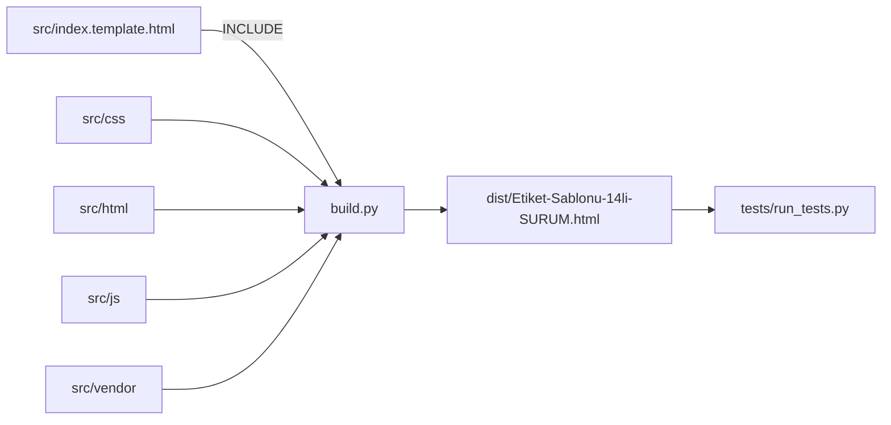

# Mimari

- Tek global kapsam: JS parçaları sırayla birleştirilir (satır içi `onclick` için).
- Veri: `labels` dizisi; localStorage `etiket14-data`; IndexedDB `EtiketDB/sablonlar`.
- Satır yüksekliği: `satirGuncelle()` dinamik `<style id="satir-css">` yazar.
